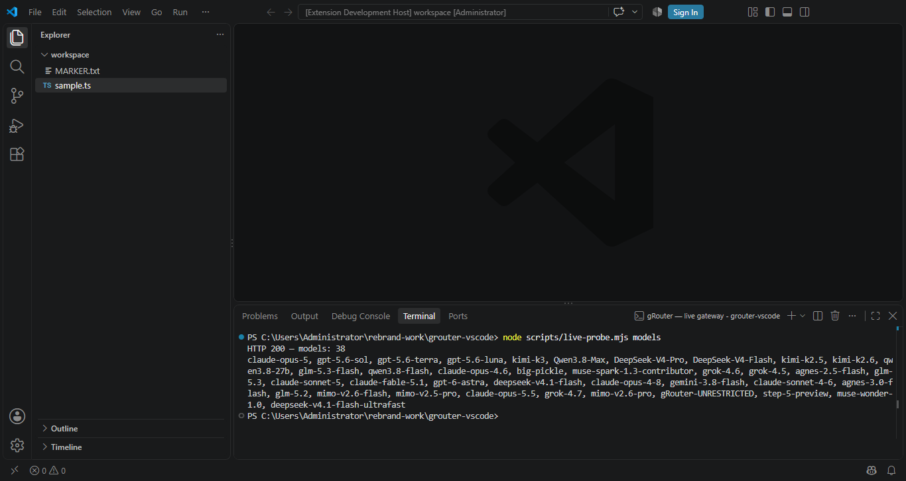
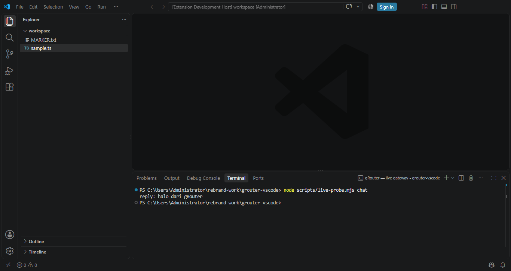

# gRouter — AI Coding, Debugging & Planning for VS Code


[](https://marketplace.visualstudio.com/items?itemName=grouter.grouter-code)
[](https://marketplace.visualstudio.com/items?itemName=grouter.grouter-code)
[](LICENSE)
[](https://t.me/grouteerbot)

**Four modes. One gateway. Zero API-key sprawl.**

gRouter puts a chat assistant, an autonomous coding agent, a durable planner,
and a real debugger inside VS Code — all running through the
**[gRouter model gateway](https://prod.grouter.web.id)**, so one key gives you
every frontier model instead of one key per provider.

```
@grouter /agent fix the failing tests         ← autonomous coding, every edit approved
@grouter /ralph fix CI until tests pass       ← keeps working until verification is green
@grouter /plan add OAuth login                ← durable plan, approve it step by step
@grouter /debug why does auth.spec.ts fail?   ← real debugger state + test output
@grouter what does this repo do?              ← chat with visible reasoning
```

---

## Why gRouter

Most AI coding extensions lock you to one vendor, hide the reasoning, and burn
tokens on context you don't need. This one doesn't.

|  | gRouter | Typical extension |
|---|---|---|
| **Models** | Every model on the gateway — switch with one command, no new key | One vendor, one billing account per provider |
| **Reasoning** | Thinking shown in a collapsible block you can inspect | Hidden, or summarized away |
| **Mutations** | Every write / command / git action gated by an approval prompt | Silent edits, trust the model |
| **Destructive ops** | `rm -rf`, `git reset --hard`, force-push, `curl \| sh` can **never** be auto-approved | Usually just "always allow" |
| **Done means done** | A "tests pass" claim is re-verified with real tests + typecheck; red evidence **blocks** the claim | Trusts the model's summary |
| **Visibility** | Live status bar: mode, iteration, tool calls, tokens, last verification | Nothing, or a spinner |
| **Context** | Model-aware budget read from `/v1/models` — no hardcoded 200k | Fixed window, silent truncation |
| **MCP** | Both directions: consume external servers **and** expose your tools | Client-only, if at all |
| **Plans** | Durable checkpoints in SQLite, resumable across window reloads | Lost on reload |

---

## Powered by the gRouter gateway

gRouter runs on **[gRouter](https://prod.grouter.web.id)** — *Premium AI API
Gateway*: an OpenAI-compatible endpoint (9Router engine) that fronts the major
model providers behind a single URL and a single key.

- **One key, every model** — `https://prod.grouter.web.id/v1`, drop-in OpenAI-compatible
- **Switch models per task** — a cheap model for refactors, a reasoning model for hard bugs
- **Track spend in one place** — usage and limits on a single page
- **No provider sprawl** — no per-vendor billing accounts, no per-vendor keys

|  |  |
|---|---|
| **Get an API key** | [Telegram bot @grouteerbot](https://t.me/grouteerbot) — paid via QRIS, key sent automatically |
| **Check usage & limits** | [prod.grouter.web.id/check-usage](https://prod.grouter.web.id/check-usage) |
| **Questions? Ask the bot** | [t.me/grouteerbot](https://t.me/grouteerbot) |

> [!NOTE]
> **Published on the VS Code Marketplace** as
> [`grouter.grouter-code`](https://marketplace.visualstudio.com/items?itemName=grouter.grouter-code).
> Install straight from the Marketplace, or grab the VSIX below for a manual,
> offline install.

## Install

### From the VS Code Marketplace (recommended)

```bash
code --install-extension grouter.grouter-code
```

Or open the [Marketplace page](https://marketplace.visualstudio.com/items?itemName=grouter.grouter-code),
or search **gRouter** in the Extensions view.

### From VSIX (offline / pinned version)

1. Download `grouter-code-0.4.0.vsix`
2. Install:

```bash
code --install-extension grouter-code-0.4.0.vsix
```

Or in VS Code: **Extensions** view → `···` menu → **Install from VSIX…**

3. **Set your API key** — command palette → **gRouter: Set API Key**, or edit
   `~/.grouter/config.json`. Get one from the [gRouterBot on Telegram](https://t.me/grouteerbot) — buy a plan with QRIS and the key is delivered automatically. Usage and limits are on [check-usage](https://prod.grouter.web.id/check-usage).

   Your key is stored in `~/.grouter/config.json` in your home directory —
   never inside a repository, never committed.

4. **Chat** — open the Chat view (`Ctrl+Alt+I`) and type `@grouter hello`.

---

## 📖 Documentation

**[→ Read the full user guide](docs/USER-GUIDE.md)** — step-by-step, written for
people using VS Code for the first time. Install, get an API key, and your first
chat, with nothing assumed.

| Guide | What's in it |
|---|---|
| **[User guide](docs/USER-GUIDE.md)** | Every step from zero: installing VS Code, installing gRouter, getting an API key, connecting it, and a first chat. Plain-language explanations of approvals, skills, sub-agents and MCP. Full command, setting and troubleshooting reference. |
| [Verification report](docs/VERIFICATION.md) | What was actually run against the live gateway, with the raw output |
| [Architecture](docs/ARCHITECTURE.md) | How the extension is put together |
| [Changelog](CHANGELOG.md) | What changed in each release |
| [Feature audit](docs/AUDIT-FITUR.md) | Every feature checked against a running VS Code: which ones were silently dead, why the test suite missed them, and what now guards against it |
| [Fixing the 0.3.1 chat error](docs/FIX-0.3.2.md) | Plain-language explanation of the `proxy ... markdown` error, and how to update |

> **New to this? Start with the [user guide](docs/USER-GUIDE.md).** It assumes
> nothing — no terminal experience, no prior extension installs — and gets you
> from a bare machine to a working chat.

## Verified against the live gateway

Setiap gambar di bawah diambil langsung dari VS Code yang menjalankan build ini —
bukan mockup, bukan komposisi grafis.

**Test suite — 198 unit test hijau di terminal VS Code yang sebenarnya, ditambah 17 extension-host test di dalam instance VS Code sungguhan** (`npm run test:host`)


**`GET /v1/models` — 38 models reachable with a single key**



**`POST /v1/chat/completions` — live completion**



## What 0.4.0 adds — and the screenshots that prove it

Every image below was captured from a **live VS Code 1.142.0 instance** with the
packaged extension activated — the same APIs you exercise, not a mockup. The
captures are produced by `npm run shots`, which photographs the real workbench
over the DevTools protocol.

| Feature | What it does | Screenshot |
|---|---|---|
| **Verify gate** | Refuses to let the agent claim "done" without evidence. No test command = rejected, not green. | `assets/shot-verify.png` |
| **Ralph mode** (`/ralph`) | Loops work → verify → fix, and stops with an honest reason. Hitting the iteration cap reports work as **unverified**. | `assets/shot-ralph.png` |
| **HUD** | Live status bar: mode, step, tool calls, tokens, verification state. | `assets/shot-hud.png` |
| **Chat + ralph HUD** | The `@grouter` participant and the HUD running together. | `assets/shot-chat.png` |

### The gate in action


The agent said the work was done. The gate ran the project's real checks, found
**no test command at all**, and refused to call that green — reporting each check
as `skipped` with the reason instead of silently passing. That behaviour is the
whole point of 0.4.0, and it is what the 7 new `verify_work` tests pin down.


The same honesty in the loop: `/ralph` burned its iteration budget and said so —
*"iteration limit reached, work NOT verified"* — rather than declaring victory.


The HUD, read straight off the real status bar: `gRouter · agent · step 2/4 · 3 tools · 13.3k · ⓧ`

### UI verification status

The in-editor UI is now exercised, not assumed:

- **17 host tests** run inside a real VS Code instance (`npm run test:host`) —
  they assert the API surface, activation, command registration, chat
  participant wiring, tool registration and filesystem features against the
  host's real implementation rather than a hand-written stub.
- **6 screenshots** are captured from the same live host (`npm run shots`) — chat, verify,
  ralph, HUD, and two real gateway round-trips (`/v1/models`, `/v1/chat/completions`).
- The verify gate and the ralph loop are additionally covered by 198 unit tests
  plus an end-to-end check: an empty project plus a "tests pass" claim produces
  `allow: false`.

**Still untested:** approval prompts, the plan panel and the debugger UI have no
automated coverage — they are described as designed, not as verified.

## Commands

| Command | What it does |
|---|---|
| `@grouter <question>` | Chat with workspace context + reasoning display |
| `@grouter /agent <task>` | Autonomous coding: reads, edits, runs commands, verifies — every mutation approved |
| `@grouter /ralph <task>` | Persistence mode: loops work → verify → fix until tests/typecheck are actually green |
| `@grouter /plan <goal>` | Generate a durable plan; `/plan execute` runs it step-by-step |
| `@grouter /debug <problem>` | Investigate failures using real debugger + test state |
| `@grouter /skills` | List installed skills with objectives and usage |
| `@grouter /mcp` | Show MCP server connection status |
| `@grouter /help` | Command reference |

Palette commands: **Set API Key** · **Select Model** · **Test Connection** · **Verify Work** · **Show Last Verification Report** · **Open Config** · **Show Diagnostics** · **Start MCP Server** · **Reconnect MCP Servers** · **Open Plan**

**Select Model** lists every model your gRouter plan can reach — swap models
mid-session without touching a config file or adding another key.

## Features

### Chat with reasoning
Streams answers with the model's thinking shown in a collapsible block (when the model supports it). Context comes from your active file/selection, `#`-referenced files, and workspace diagnostics — with an explicit token budget and omission notes.

### Coding agent with approvals
Every mutating action (file writes, terminal commands, git operations) requires confirmation. Read-only tools run freely. Destructive commands (`rm -rf`, `git reset --hard`, force push, `curl | sh`) can never be auto-approved. In untrusted workspaces, all mutations are disabled.

### Verify gate — done means proven

The single most common failure mode of an AI coding agent is claiming success on
a broken tree. gRouter now refuses to let that happen.

Before a turn can close, the response is scanned for a completion claim
("all tests pass", "everything works", "done"). If one is found, the project's
**real** verification runs — test suite, typecheck, and `git diff --stat` — and
the actual exit codes are read:

| Verdict | What happens |
|---|---|
| Evidence green | The turn closes; the evidence table is shown in chat |
| Evidence red | The claim is **rejected**: the turn is marked `unverified`, the failing command and its output are quoted, and the agent is told exactly what to fix |
| Nothing to verify | Also rejected as *unverifiable* — "tests pass" with no test suite is still an unsupported claim |

The scan is not naive: "tests still fail", "I could not verify", "should pass"
and questions are **not** treated as claims. Read-only modes (`ask`, `/skills`,
`/mcp`, `/help`) are never gated.

Turn it off with `grouter.verify.enabled`, or keep the warning but allow the turn
with `grouter.verify.blockOnUnverified`.


*Captured from a real VS Code session: the agent claimed success, the gate ran
the actual checks, found nothing to verify, and refused to call it green.*

### Ralph mode — persistence until verified

`/ralph` wraps the agent in an outer loop: **work → verify → feed the failure back
→ work again**. Evidence is collected by the loop, not by the agent, so the agent
cannot skip or fake the check. It stops with an honest status:

| Stop reason | Meaning |
|---|---|
| `verified` | Every check is green — the only success state |
| `max-iterations` | Budget exhausted, work **NOT** verified |
| `no-progress` | The same failure repeated — stops before burning more tokens |
| `canceled` | You stopped it |
| `aborted` | The agent run threw |

``` 
@grouter /ralph fix the failing parser tests
```

Iteration count and stall limit: `grouter.ralph.maxIterations` (default 5) and
`grouter.ralph.stallLimit` (default 2).


*A real `/ralph` run: the loop hit its budget and reported the work as
**not verified** instead of claiming success.*

### HUD — see what is happening

A live status bar item shows the running mode, ralph iteration, plan step, tool
call count, token usage and the last verification state:


*A real status bar, captured mid-run: `gRouter · agent · step 2/4 · 3 tools · 13.3k`.*

```
$(refresh~spin) gRouter · ralph · 2/5 · 14 tools · 12.4k · $(error)
```

Disable with `grouter.hud.enabled`.

### Planning mode
Plans are durable artifacts stored in SQLite with step-by-step execution, per-step approval, skip/abort, and in-session resume via LangGraph checkpointing (checkpoints are in-memory; after a window reload the plan resumes at the step level from SQLite).

### Debug mode
Reads **real runtime state** via the debug adapter: threads, stack frames, scopes, and variables at a breakpoint. Runs your test suite (auto-detects npm/pytest/cargo/go) and parses failures from vitest/jest/mocha/pytest/cargo output. Evidence-first: reproduce → read state → one hypothesis → fix root cause → verify.

### Sub-agent specialists
Delegate focused work to isolated specialists: **explorer** (map unfamiliar code), **researcher** (investigate dependencies), **reviewer** (independent diff review), **tester** (run verification). All read-only; the parent agent owns every mutation.

### 25 built-in skills
Markdown playbooks in `~/.grouter/skills/` — each with an objective, goals, and triggers. Matched automatically by your prompt and injected into the agent's context.

**Debugging · Code Review · Refactoring · Test Writing · Planning · API Integration · Error Handling · Security Review · Performance · TypeScript Strict · Git Workflow · Code Exploration · Dependency Management · Async & Concurrency · Data Modeling · CLI Development · Frontend & UI · Documentation · Release Management · Incident Response · Log & Output Analysis · Context Management · Tool Orchestration · Prompt Engineering · Skill Authoring**

Skills are plain markdown — edit them, delete them, or ask the agent to create new ones (`create_skill` tool). The agent also learns reusable procedures from completed sessions automatically.

### MCP — both directions

**Consume** external MCP servers — add them to `.vscode/mcp.json`, `.mcp.json`, or `~/.grouter/mcp.json`:

```json
{
  "servers": {
    "filesystem": {
      "command": "npx",
      "args": ["-y", "@modelcontextprotocol/server-filesystem", "."]
    }
  }
}
```

**Expose** gRouter's tools as an MCP server — two modes via **gRouter: Start MCP Server**:

- **In-editor (recommended)** — a localhost HTTP endpoint (`http://127.0.0.1:3987/mcp`) where **every mutating tool prompts you in VS Code** through the approval gate before running.
- **Standalone (auto-approves)** — spawns `dist/mcp-server.js` in a terminal with **no approval prompts**; use only in trusted workspaces. External clients can also connect directly:

```json
{
  "mcpServers": {
    "grouter": {
      "command": "node",
      "args": ["<extension-path>/dist/mcp-server.js", "--workspace", "<your-repo>"]
    }
  }
}
```

> Prefer the in-editor mode for interactive use — it enforces approvals. The standalone mode is for trusted, automated scenarios.

### Built-in tools (26 in-editor, 12 in the standalone MCP server)
Read: `read_file` · `list_dir` · `search_text` · `find_files` · `get_workspace_tree` · `get_diagnostics` · `get_open_editors` · `get_selection` · `git_status` · `git_diff` · `get_debug_state` · `list_breakpoints` · `fetch_url` · `list_skills` · `read_skill`
Mutating (approval required): `apply_patch` · `write_file` · `run_command` · `run_tests` · `set_breakpoint` · `remove_breakpoint` · `launch_debug` · `create_skill` · `delete_skill` · `delegate_to_specialist`
Verification: `verify_work` — runs the project's real tests + typecheck and returns exit codes

## Configuration

All settings live in `~/.grouter/config.json`:

```json
{
  "apiKey": "gRouter-...",
  "baseUrl": "https://prod.grouter.web.id/v1",
  "model": "DeepSeek-V4-Flash",
  "maxOutputTokens": 8192,
  "reasoning": { "show": true, "effort": "high" },
  "agent": { "maxIterations": 25, "autoApprove": [], "learnSkills": true },
  "verify": {
    "enabled": true,
    "blockOnUnverified": true,
    "testCommand": "",
    "typecheckCommand": "",
    "timeoutSeconds": 180
  },
  "ralph": { "maxIterations": 5, "stallLimit": 2 },
  "hud": { "enabled": true },
  "tools": { "truncateKB": 64 },
  "telemetry": { "enabled": false }
}
```

`baseUrl` defaults to the gRouter gateway, so a stock install talks to
`https://prod.grouter.web.id/v1` with nothing but your key. Point it at any other
OpenAI-compatible endpoint if you prefer.

VS Code settings (Settings UI → search "grouter"):

| Setting | Default | Purpose |
|---|---|---|
| `grouter.mcp.port` | `3987` | Localhost port for the in-editor MCP server |
| `grouter.baseUrl` | gateway URL | Override the API endpoint |
| `grouter.model` | (empty) | Default model id |
| `grouter.reasoning.show` | `true` | Show/hide the thinking block |
| `grouter.verify.enabled` | `true` | Run the verify gate on completion claims |
| `grouter.verify.blockOnUnverified` | `true` | Reject a "done" claim when evidence is red |
| `grouter.verify.testCommand` | (auto) | Override the detected test command |
| `grouter.verify.typecheckCommand` | (auto) | Override the detected typecheck command |
| `grouter.verify.timeoutSeconds` | `180` | Per-command verification timeout |
| `grouter.ralph.maxIterations` | `5` | Max iterations for `/ralph` |
| `grouter.ralph.stallLimit` | `2` | Stop when the same failure repeats |
| `grouter.hud.enabled` | `true` | Show the status bar HUD |

## Storage

```
~/.grouter/
├── config.json          ← settings + API key
├── grouter.db           ← SQLite: sessions, messages, memory, knowledge, tool usage, plans
├── sessions/<id>/
│   └── state.json       ← per-session JSON state (counters, active plan, files changed)
├── skills/*.md          ← skill playbooks (edit freely)
└── mcp.json             ← optional global MCP server config
```

Sessions resume automatically for the same workspace (within 12 hours) across window reloads. Session scratch files go to your OS temp dir (`%TEMP%/grouter/<id>/`) and are cleaned up on deactivate, never touching the workspace.

## Requirements

- VS Code 1.140+
- A gRouter API key (`grx_...`) — **buy one from the [Telegram bot](https://t.me/grouteerbot)** (paid via QRIS, delivered automatically). There is no free signup or self-service dashboard.

## Troubleshooting

| Symptom | Fix |
|---|---|
| "No API key configured" | Run **gRouter: Set API Key** or edit `~/.grouter/config.json` |
| Connection timeout | The gateway needs IPv4 on some networks (handled automatically); check `grouter.baseUrl` |
| Model errors | Run **gRouter: Select Model** to see models available to your plan |
| Rate limited | Wait for the window to reset (`/help` shows status bar quota); the client retries automatically with backoff |
| MCP server not connecting | Check `/mcp` for the error message; verify the command works in a terminal |
| In-editor MCP port busy | Change `grouter.mcp.port` in Settings, then re-run **gRouter: Start MCP Server** |
| "Verify gate: klaim selesai ditolak" | The agent claimed success while tests/typecheck were red. Read the quoted output, or run **gRouter: Verify Work** to see the full report |
| Verify gate blocks everything | Your project has no test script. Add one, set `grouter.verify.testCommand`, or turn off `grouter.verify.blockOnUnverified` |
| `/ralph` stops as "BELUM terverifikasi" | It ran out of iterations or stopped making progress. Read the failure it reports — do not treat the task as done |
| Plan missing after reload | Plans are stored per session; sessions resume within 12h — `/plan list` shows the current session's plans |

Diagnostics: **gRouter: Show Diagnostics** opens the output channel with version, model, config path, and recent errors.

## License

MIT
