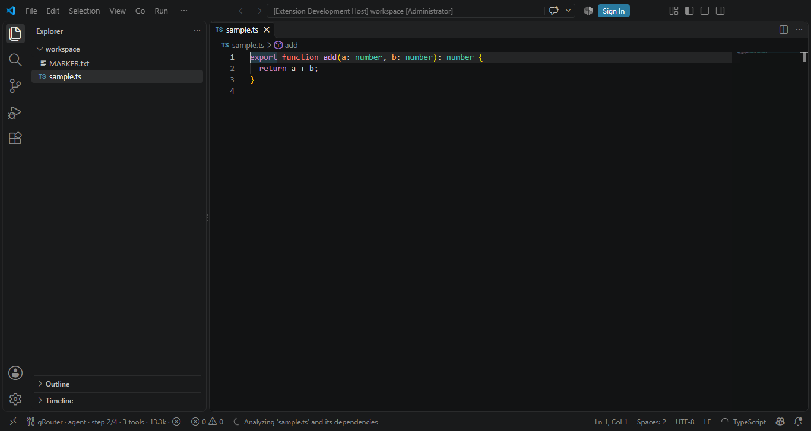

# gRouter — Panduan Lengkap Pemakaian

> **Buat siapa dokumen ini?** Buat siapa aja — termasuk yang baru pertama kali pakai VS Code.
> Semua langkah ditulis apa adanya, gak ada singkatan yang bikin bingung.
> Ikutin dari atas ke bawah, 10 menit kelar.

---

## Daftar Isi

1. [Apa itu gRouter?](#1-apa-itu-grouter)
2. [Yang perlu disiapin](#2-yang-perlu-disiapin)
3. [Langkah 1 — Install VS Code](#3-langkah-1--install-vs-code)
4. [Langkah 2 — Install gRouter](#4-langkah-2--install-grouter)
5. [Langkah 3 — Ambil API Key](#5-langkah-3--ambil-api-key)
6. [Langkah 4 — Masukin API Key](#6-langkah-4--masukin-api-key)
7. [Langkah 5 — Tes pertama kali](#7-langkah-5--tes-pertama-kali)
8. [Cara pakai sehari-hari](#8-cara-pakai-sehari-hari)
9. [Penjelasan 6 mode](#9-penjelasan-6-mode)
10. [Semua command](#10-semua-command)
11. [Verifikasi: bukti, bukan klaim](#11-verifikasi-bukti-bukan-klaim)
12. [Semua pengaturan](#12-semua-pengaturan)
13. [Konsep penting](#13-konsep-penting)
14. [Kalau ada masalah](#14-kalau-ada-masalah)
15. [Pertanyaan umum (FAQ)](#15-pertanyaan-umum-faq)

---

## 1. Apa itu gRouter?

**gRouter itu asisten AI yang hidup di dalam VS Code.** Dia bisa:

- **Nulis & benerin kode** — lo bilang mau apa, dia kerjain
- **Ngejelasin kode** — "file ini ngapain?" → dia jelasin
- **Nyari bug** — dia baca data runtime asli, bukan nebak
- **Bikin rencana** — kerjaan besar dipecah jadi langkah-langkah
- **Jalanin test** — dia jalanin, baca hasilnya, dan benerin yang gagal

**Yang bikin beda dari yang lain:**

| | gRouter | Extension lain |
|---|---|---|
| Model | **38 model** (Claude, GPT, Kimi, Qwen, DeepSeek) | Biasanya cuma 1 vendor |
| Cara mikir | **Kelihatan**, bisa lo baca | Disembunyiin |
| Kalau nulis file | **Nanya izin dulu** | Langsung tulis |
| Command bahaya | **Gak bisa** di-whitelist | Bisa "always allow" |

> **Penting buat dipahami:** gRouter **butuh API key** dan **butuh koneksi internet**.
> Dia bukan AI yang jalan di komputer lo sendiri — dia nyambung ke server gRouter
> di `https://prod.grouter.web.id`. Jadi ada biaya pemakaian (tinggal cek di halaman usage).

---

## 2. Yang perlu disiapin

Cek dulu, punya lo udah ada apa belum:

- [ ] **Komputer** — Windows, macOS, atau Linux
- [ ] **VS Code** versi **1.140.0 atau lebih baru** ([download di sini](https://code.visualstudio.com))
- [ ] **Internet** — wajib, karena AI-nya jalan di server
- [ ] **API Key gRouter** (`grx_...`) — **beli via bot Telegram** https://t.me/grouteerbot, detailnya di [Langkah 3](#5-langkah-3--ambil-api-key)

**Cara cek versi VS Code lo:** buka VS Code → klik menu **Help** → **About**. Lihat tulisan `Version: 1.xx.x`. Angka pertama setelah titik harus `140` atau lebih besar.

---

## 3. Langkah 1 — Install VS Code

**Kalau VS Code udah ada di komputer lo, lewatin bagian ini** dan lanjut ke [Langkah 2](#4-langkah-2--install-grouter).

### Cara paling gampang

1. Buka https://code.visualstudio.com
2. Klik tombol biru besar **Download for Windows** (atau macOS/Linux sesuai komputer lo)
3. Buka file yang ke-download (namanya kayak `VSCodeUserSetup-x64-1.xx.exe`)
4. Klik **Next** terus sampai selesai → **Finish**

> **Windows: INI PENTING.** Di halaman instalasi ada centang **"Add to PATH"**.
> **Jangan di-uncheck!** Kalau gak, nanti command `code` di terminal gak jalan.

### Cara lewat terminal (kalau lo suka)

Buka **PowerShell** di Windows, atau **Terminal** di macOS/Linux, lalu ketik:

```powershell
winget install Microsoft.VisualStudioCode
```

**macOS pakai Homebrew:**
```bash
brew install --cask visual-studio-code
```

### ✅ Cek berhasil

Buka VS Code. Kalau jendelanya kebuka → **berhasil**.

**Sekarang tes command `code` di terminal:**
1. **Tutup semua terminal** yang lagi kebuka (ini penting biar PATH ke-refresh)
2. Buka terminal baru
3. Ketik: `code --version`

Kalau muncul angka versi (contoh: `1.140.0`) → **mantap, lanjut.**

**Kalau muncul error `command not found` atau `'code' is not recognized`:**

Buka VS Code → tekan `Ctrl+Shift+P` → ketik **`Shell Command: Install 'code' command in PATH`** → Enter. Tutup terminal, buka lagi, coba lagi.

---

## 4. Langkah 2 — Install gRouter

Ada **2 cara**. Pilih salah satu — cara A lebih gampang.

### Cara A — Dari Marketplace (rekomendasi)

**Lewat tampilan VS Code:**

1. Buka **VS Code**
2. Tekan `Ctrl+Shift+X` — ini buka panel **Extensions** (di Mac: `Cmd+Shift+X`)
3. Di kotak pencarian, ketik: **`gRouter`**
4. Cari yang namanya **gRouter**, penerbitnya **grouter**
5. Klik tombol **Install**
6. Tunggu sampai tombolnya berubah jadi **Installed**

**Lewat terminal:**
```bash
code --install-extension grouter.grouter-code
```

**Lewat browser:** buka https://marketplace.visualstudio.com/items?itemName=grouter.grouter-code → klik **Install**.

### Cara B — Dari file VSIX (offline / mau versi tertentu)

Pakai cara ini kalau lo gak ada internet di komputer itu, atau mau kunci versi tertentu.

1. Download file `grouter-code-0.4.0.vsix`
2. **Lewat VS Code:** tekan `Ctrl+Shift+X` → klik tombol **`···`** (titik tiga, di kanan atas panel) → pilih **Install from VSIX...** → cari file `.vsix` tadi → **Open**
3. **Lewat terminal:**
   ```bash
   code --install-extension grouter-code-0.4.0.vsix
   ```

### ✅ Cek berhasil

Tekan `Ctrl+Shift+P` → ketik **`gRouter`**. Kalau muncul daftar kayak `gRouter: Set API Key`, `gRouter: Select Model` → **berhasil keinstall.**

> **Kalau gak muncul apa-apa:** cek versi VS Code lo minimal 1.140.0 (Help → About).
> Kalau versinya lebih tua, update dulu: **Help → Check for Updates**.

---

## 5. Langkah 3 — Ambil API Key

gRouter **gak bisa jalan tanpa API key**. Ini kayak kunci rumah — tanpa itu pintunya gak kebuka.

### Penting: API key itu **dibeli**, bukan didaftarkan gratis

gRouter **gak punya** pendaftaran akun gratis atau dashboard tempat lo bikin key
sendiri. API key-nya **dibeli lewat bot Telegram**, dibayar pakai QRIS, lalu
key-nya **dikirim otomatis** ke chat lo.

### Langkahnya

**1. Buka bot Telegram**

👉 **https://t.me/grouteerbot**

Klik **START** / **Buka Bot Telegram**.

**2. Pilih paket**

Bot-nya bakal nunjukin daftar paket, contohnya:

| Paket | Token | Harga |
|---|---|---|
| Starter | 15 juta token | Rp19.000 |

Berlaku 30 hari, sekali bayar langsung aktif.

**3. Bayar pakai QRIS**

Bot-nya ngasih kode QRIS. Scan pakai m-banking atau e-wallet lo
(GoPay, OVO, DANA, ShopeePay, dsb).

**4. Terima API key otomatis**

Setelah pembayaran masuk, key-nya **langsung dikirim ke chat** — gak perlu nunggu
admin, gak perlu nunggu lama.

Key-nya diawali **`grx_`**, contoh bentuknya:

```
grx_xxxxxxxxxxxxxxxxxxxxxxxxxxxxxxxx
```

**5. Copy key-nya**

Itu yang lo masukin ke gRouter nanti (Langkah 4 di bawah).

### Kalau bingung atau ada masalah

- 💬 **Chat admin:** https://t.me/gjproproject
- 🤖 **Bot-nya sendiri:** https://t.me/grouteerbot
- 📊 **Cek pemakaian & sisa token:** https://prod.grouter.web.id/check-usage

### ⚠️ AWAS — baca ini

- **Copy key-nya begitu diterima.** Kalau chat-nya kehapus, lo harus chat bot lagi.
- **Jangan pernah** kirim key ke orang lain, atau tempel di screenshot.
- **Jangan pernah** tulis key langsung di dalam kode lo.
- Key ini **berbayar** — kalau bocor, token lo bisa kepakai orang lain.

### Butuh bantuan?

- 📊 **Cek pemakaian & limit:** https://prod.grouter.web.id/check-usage
- 🤖 **Tanya bot:** https://t.me/grouteerbot

---

## 6. Langkah 4 — Masukin API Key

Ini langkah yang **paling sering kelupaan**. Kalau dilewatin, extension-nya bakal balas error terus.

1. Buka **VS Code**
2. Tekan `Ctrl+Shift+P` (di Mac: `Cmd+Shift+P`) — ini buka **Command Palette**
3. Ketik: **`gRouter: Set API Key`**
4. Klik / Enter
5. Muncul kotak input di atas — **paste API key** lo → Enter

### ✅ Cek berhasil

Tekan `Ctrl+Shift+P` → ketik **`gRouter: Test Connection`** → Enter.

Kalau muncul pesan **sukses/connected** → **mantap!** Kalau muncul error, lompat ke [Kalau ada masalah](#13-kalau-ada-masalah).

### Key lo disimpen di mana?

Di file `config.json` di folder home lo:

- **Windows:** `C:\Users\NamaLo\.grouter\config.json`
- **macOS/Linux:** `~/.grouter/config.json`

**Penting:** file ini ada **di luar** folder project lo, jadi **gak bakal ke-commit ke git**. Key lo aman.

**Mau edit manual?** Tekan `Ctrl+Shift+P` → **`gRouter: Open Config File (~/.grouter/config.json)`**.

---

## 7. Langkah 5 — Tes pertama kali

Sekarang buktiin semuanya jalan.

1. Buka **VS Code**
2. Buka folder project lo: **File → Open Folder** → pilih folder mana aja
3. Tekan `Ctrl+Alt+I` — ini buka **panel Chat** (di Mac: `Ctrl+Cmd+I`)
4. Ketik: **`@grouter hello`**
5. Enter

### Yang harusnya kejadian

Panel chat nampilin balasan dari AI. **Kalau dibalas → SELESAI, udah bisa dipakai!** 🎉

### Coba yang lebih berguna

Setelah `hello` jalan, coba ini:

```
@grouter /ask jelasin struktur folder project ini
```

```
@grouter /ask file package.json ini buat apa?
```

```
@grouter /help
```

---

## 8. Cara pakai sehari-hari

### Alur dasar

Ketik **`@grouter`** di chat, terus tulis pertanyaan atau perintah lo. Contoh:

| Mau ngapain | Ketik ini |
|---|---|
| Nanya soal kode | `@grouter /ask kenapa fungsi ini error?` |
| Nyuruh benerin | `@grouter /agent tambahin validasi di login form` |
| Bikin rencana dulu | `@grouter /plan migrasi project ini ke TypeScript` |
| Nyari bug | `@grouter /debug test login gagal terus` |
| Lihat skill | `@grouter /skills` |
| Lihat status MCP | `@grouter /mcp` |
| Buka bantuan | `@grouter /help` |

### Tips bikin hasilnya bagus

**1. Sebutin file yang lo maksud**

Jangan: `benerin bug itu`
Tapi: `benerin bug di src/auth/login.ts baris 42`

**2. Kasih tau hasil yang lo mau**

Jangan: `perbaiki kodenya`
Tapi: `perbaiki supaya kalau input kosong, muncul pesan error — bukan crash`

**3. Buat kerjaan besar, pakai `/plan` dulu**

Kerjaan kayak "refactor seluruh project" jangan langsung `/agent`. Pakai `/plan` dulu, lo bisa lihat langkahnya, baru setujui satu-satu.

**4. Blok kode pilih dulu**

Di editor, **blok** kode yang mau lo bahas → dia otomatis kebaca sebagai konteks. Atau pakai `#namafile` buat nunjuk file lain.

**5. Kalau dia salah, bilang aja**

`bukan itu, maksud gue di file utils.ts` — dia bakal nyesuaiin.

### Ngobrol pakai bahasa apa?

**Bebas.** Bahasa Indonesia, English, campur — semua jalan. Contoh:

```
@grouter /ask ini kenapa memory leak ya? jelasin pakai bahasa gampang
```

---

## 9. Penjelasan 6 mode

gRouter punya 5 mode. Bedanya di **seberapa banyak yang dia boleh lakuin**.

| Mode | Boleh ngapain | Aman? | Kapan dipake |
|---|---|---|---|
| **`/ask`** | Cuma baca. Gak bisa ngubah apa-apa | 🟢 Paling aman | Nanya, belajar kode, cari info |
| **`/plan`** | Bikin rencana, gak ngubah kode | 🟢 Aman | Kerjaan besar, mau lihat langkahnya dulu |
| **`/debug`** | Baca data runtime + jalanin test | 🟡 Hati-hati | Nyari bug, investigasi error |
| **`/agent`** | **Bisa ngubah kode** — tapi nanya izin | 🟡 Hati-hati | Ngerjain tugas coding |
| **`/ralph`** | Sama kayak `/agent`, tapi **ngulang terus sampai test hijau** | 🟡 Hati-hati | "Benerin sampai lulus", bukan "coba sekali" |
| **`/mcp`, `/skills`, `/help`** | Cuma nampilin info | 🟢 Aman | Lihat status |

### `/ask` — tanya jawab

**Cuma baca.** Gak akan nyentuh file lo. Cocok buat:
- "File ini ngapain?"
- "Jelasin alur autentikasi di project ini"
- "Ada bug gak di fungsi ini?"

### `/plan` — bikin rencana

Dia bikin **rencana langkah demi langkah**, disimpen ke database. **Belum ngubah kode apa-apa.**

Enaknya: rencananya **tahan reload**. Tutup VS Code, buka lagi, rencananya masih ada.

```
@grouter /plan tambahin fitur export CSV di halaman laporan
```

- `@grouter /plan list` — lihat semua rencana
- `@grouter /plan run <nama>` — jalanin rencananya
- Tiap langkah **bisa lo setujui satu-satu**, atau skip, atau batalin

### `/debug` — cari bug

Ini yang paling beda dari extension lain: dia **baca data runtime asli** — bukan nebak dari kode.

Dia bisa lihat:
- **Threads** — apa aja yang jalan
- **Stack frames** — urutan pemanggilan fungsi
- **Scopes** — variabel di cakupan mana
- **Variables** — nilai asli variabel di titik breakpoint

Dia juga **jalanin test** lo otomatis (deteksi npm/pytest/cargo/go) dan **baca hasil gagalnya** dari vitest/jest/mocha/pytest/cargo.

**Alurnya:** reproduksi → baca state → satu hipotesis → benerin akar masalah → verifikasi.

```
@grouter /debug test checkout selalu gagal dengan error 500
```

### `/agent` — kerja beneran

Ini yang **bisa ngubah kode lo**. Tapi **tiap perubahan harus lo setujui dulu.**

Yang perlu lo tau:
- **Baca file** → jalan bebas
- **Nulis file / jalanin command / operasi git** → **MUNCUL PROMPT, lo harus klik setuju**
- **Workspace yang belum dipercaya** → semua perubahan **dimatiin**

### `/ralph` — kerja sampai beneran kelar

`/agent` itu **sekali jalan**. Kalau test-nya masih merah, dia bisa aja bilang "udah gue coba" terus berhenti.

`/ralph` **nggak berhenti** sebelum verifikasi beneran hijau. Caranya:

```
kerja → cek (test + typecheck) → kalau merah, baca error-nya → kerja lagi
```

Yang penting: **yang ngecek itu sistemnya, bukan agent-nya.** Jadi agent gak bisa ngakalin atau ngelewatin pengecekan.

``` 
@grouter /ralph benerin test parser yang gagal
```

**Hasil akhirnya selalu jujur:**

| Status | Artinya |
|---|---|
| ✅ `verified` | Semua hijau. **Ini satu-satunya status sukses** |
| ⚠️ `max-iterations` | Kehabisan jatah putaran. Kerjaan **BELUM terverifikasi** |
| ⚠️ `no-progress` | Error-nya sama terus — berhenti biar token lo gak kebuang |
| ⏹ `canceled` | Lo yang stop |
| ❌ `aborted` | Ada error pas jalan |

Kalau statusnya `max-iterations`, **jangan anggap selesai.** Baca error yang dia laporin, atau naikin jatahnya di pengaturan `grouter.ralph.maxIterations`.

---

## 10. Semua command

### Command Palette (`Ctrl+Shift+P`)

| Command | Buat apa |
|---|---|
| `gRouter: Set API Key` | Masukin / ganti API key |
| `gRouter: Test Connection` | Cek koneksi ke server gRouter |
| `gRouter: Select Model` | Pilih model (dari 38 yang tersedia) |
| `gRouter: Show Diagnostics` | Lihat status & log buat troubleshooting |
| `gRouter: Open Config File (~/.grouter/config.json)` | Buka `~/.grouter/config.json` |
| `gRouter: Open Plan` | Buka rencana yang udah dibikin |
| `gRouter: Start MCP Server` | Nyalain MCP server |
| `gRouter: Reconnect MCP Servers` | Nyambungin ulang MCP server |
| `gRouter: Verify Work (tests + typecheck)` | Jalanin verifikasi manual sekarang juga |
| `gRouter: Show Last Verification Report` | Lihat hasil verifikasi terakhir |

### Command di dalam chat

| Command | Buat apa |
|---|---|
| `@grouter /ask <pertanyaan>` | Tanya soal kode (cuma baca) |
| `@grouter /agent <tugas>` | Suruh ngerjain tugas coding |
| `@grouter /ralph <tugas>` | Sama kayak `/agent`, tapi **ngulang sampai test hijau** |
| `@grouter /plan <tujuan>` | Bikin rencana langkah demi langkah |
| `@grouter /debug <masalah>` | Investigasi bug & test |
| `@grouter /skills` | Lihat daftar skill |
| `@grouter /mcp` | Lihat status MCP server |
| `@grouter /help` | Tampilkan bantuan |

### Shortcut keyboard

| Tombol | Fungsi |
|---|---|
| `Ctrl+Alt+I` | Buka panel Chat (`Ctrl+Cmd+I` di Mac) |
| `Ctrl+Shift+P` | Buka Command Palette |
| `Ctrl+Shift+X` | Buka panel Extensions |

---

## 11. Verifikasi: bukti, bukan klaim

Ini fitur yang paling beda dari extension lain, dan yang paling sering nyelametin.

### Masalah yang dia selesaikan

AI coding agent itu **sering bohong tanpa sengaja**. Dia nulis kode, jalanin test
sekali, test-nya merah, tapi dia tetep bilang:

> "Semua test sudah lulus ✅"

Lo percaya, lo commit, CI merah, lo bete.

### Cara gRouter sekarang

Sebelum jawaban agent ditutup, gRouter **baca dulu** jawabannya. Kalau di situ ada
klaim selesai — "all tests pass", "sudah selesai", "done", "everything works" —
maka gRouter **jalanin verifikasi beneran**:

| Yang dicek | Contoh command |
|---|---|
| **Test suite** | `npm test` / `pytest` / `cargo test` / `go test ./...` |
| **Typecheck** | `tsc --noEmit` (kalau ada `tsconfig.json`) |
| **Perubahan file** | `git diff --stat` |

Yang dibaca itu **exit code asli**, bukan kata-kata agent.

### Hasilnya

| Kondisi | Yang terjadi |
|---|---|
| ✅ Semua hijau | Jawaban lolos, tabel bukti ditampilkan. Aman |
| ❌ Ada yang merah | **Klaim DITOLAK.** Turn ditandai `unverified`, command yang gagal + output-nya dikutip, agent dikasih tau harus benerin apa |
| ❓ Gak ada yang bisa dicek | Juga **ditolak** — bilang "test lulus" padahal project gak punya test itu tetap klaim tanpa bukti |

Ini contoh nyata — agent ngaku selesai, gate jalanin cek yang ada, ternyata
**gak ada test sama sekali**, jadi ditolak dan tiap cek ditulis `skipped` + alasannya:


### Yang **bukan** klaim (gak digerbang)

Biar gak ganggu, kalimat ini **gak** dianggap klaim selesai:
- "tests still fail" — ngaku masih gagal, jujur
- "I could not verify" — ngaku gak bisa cek
- "should pass" — masih dugaan
- Kalimat tanya — "udah lulus belum?"

Mode baca-saja (`/ask`, `/skills`, `/mcp`, `/help`) **gak pernah** digerbang, karena
gak pernah ngaku ngubah kode.

### Cek manual

Mau lihat sendiri tanpa nunggu agent?

- **Command Palette** → **gRouter: Verify Work (tests + typecheck)**
- **Command Palette** → **gRouter: Show Last Verification Report** — lihat hasil terakhir

### Kalau ganggu

| Mau apa | Setting |
|---|---|
| Matiin total | `grouter.verify.enabled` → `false` |
| Tetep dikasih tau tapi jangan diblokir | `grouter.verify.blockOnUnverified` → `false` |
| Project gue test-nya bukan `npm test` | `grouter.verify.testCommand` → misal `pnpm test` |
| Typecheck-nya beda | `grouter.verify.typecheckCommand` → misal `mypy .` |
| Kelamaan | `grouter.verify.timeoutSeconds` → default `180` |

### HUD — lihat prosesnya

Di **status bar** VS Code (bawah) bakal muncul:

```
gRouter · ralph · 2/5 · 14 tools · 12.4k · ✗
```

Artinya: lagi di mode ralph, putaran 2 dari 5, udah 14 kali panggil tool, kepake
12.4 ribu token, dan verifikasi terakhir **merah**.

Contoh asli dari status bar (mode `agent`, step 2 dari 4):



Matiin pakai `grouter.hud.enabled` → `false`.

---

## 12. Semua pengaturan

Ubah lewat: **File → Preferences → Settings** → cari `gRouter`.
Atau: `Ctrl+Shift+P` → `Preferences: Open Settings (UI)`.

| Pengaturan | Default | Fungsinya |
|---|---|---|
| `grouter.baseUrl` | `https://prod.grouter.web.id/v1` | Alamat server gateway |
| `grouter.model` | `DeepSeek-V4-Flash` | Model default. Kosong = pilih dari daftar server |
| `grouter.reasoning.show` | `true` | Tampilin cara mikir model di chat |
| `grouter.telemetry.enabled` | `false` | Kirim data anonim (nama event aja, gak ada kode/prompt) |
| `grouter.mcp.port` | `3987` | Port MCP server lokal |
| `grouter.verify.enabled` | `true` | Jalanin verifikasi otomatis sebelum klaim selesai |
| `grouter.verify.blockOnUnverified` | `true` | Tolak klaim selesai kalau bukti merah |
| `grouter.verify.testCommand` | (otomatis) | Ganti command test. Kosong = deteksi sendiri |
| `grouter.verify.typecheckCommand` | (otomatis) | Ganti command typecheck. Kosong = deteksi sendiri |
| `grouter.verify.timeoutSeconds` | `180` | Batas waktu tiap pengecekan (detik) |
| `grouter.ralph.maxIterations` | `5` | Maksimal putaran `/ralph` |
| `grouter.ralph.stallLimit` | `2` | Berhenti kalau error sama berulang sekian kali |
| `grouter.hud.enabled` | `true` | Tampilin HUD di status bar |

> **Jangan ganti `grouter.baseUrl`** kecuali lo tau banget yang lo lakuin.
> Ganti nilai ini bikin extension-nya nyambung ke server lain.

### Pengaturan VS Code vs file config — mana yang menang?

Ada **dua** tempat nyimpen setelan:

1. **VS Code Settings** (yang di tabel atas) — enak diubah lewat UI
2. **`~/.grouter/config.json`** — file di komputer lo

**Yang menang: VS Code Settings.** Kalau lo ubah `grouter.model` di Settings,
nilai itu dipakai, walaupun `config.json` isinya beda.

Kalau lo **gak pernah** nyentuh Settings, yang dipakai isi `config.json`.
Jadi dua-duanya aman — gak ada yang nabrak.

---

## 13. Konsep penting

Beberapa hal yang bikin lo jauh lebih paham cara pakainya.

### 26 tool bawaan

Agent cuma bisa ngapa-ngapain lewat tool ini. Gak ada tool lain, gak ada akses
diam-diam.

**Baca-saja (langsung jalan, gak perlu izin)**
`read_file` · `list_dir` · `search_text` · `find_files` · `get_workspace_tree` ·
`get_diagnostics` · `get_open_editors` · `get_selection` · `git_status` ·
`git_diff` · `get_debug_state` · `list_breakpoints` · `fetch_url` ·
`list_skills` · `read_skill`

**Ngubah sesuatu (butuh izin lo dulu)**
`apply_patch` · `write_file` · `run_command` · `run_tests` · `set_breakpoint` ·
`remove_breakpoint` · `launch_debug` · `create_skill` · `delete_skill` ·
`delegate_to_specialist`

**Verifikasi**
`verify_work` — jalanin test + typecheck project yang asli, balikin exit code
mentah. Ini yang dipakai verify gate dan `/ralph`, tapi lo juga bisa manggil
langsung: **Command Palette** → **gRouter: Verify Work (tests + typecheck)**.

### Approval (izin)

Setiap kali dia mau **ngubah** sesuatu, dia **nanya dulu**. Lo bakal lihat prompt: file apa, perubahannya apa, dan pilihan **Allow** / **Deny**.

- **Baca file, cari teks, lihat struktur** → gak nanya, langsung jalan
- **Nulis file, jalanin command, git** → **selalu nanya**

**Yang gak bisa di-whitelist (permanen):**

| Command bahaya | Kenapa diblokir |
|---|---|
| `rm -rf` | Hapus file permanen |
| `git reset --hard` | Buang semua perubahan lo |
| `git push --force` | Timpa history di server |
| `curl \| sh` | Jalanin script dari internet |

Ini **gak bisa** di-"always allow". Aman dari kecelakaan.

### Skills (25 playbook bawaan)

Skill itu kayak **buku panduan** yang dia baca otomatis sesuai konteks. Semuanya file markdown biasa di `~/.grouter/skills/`.

25 yang bawaan:

| | | |
|---|---|---|
| Debugging | Code Review | Refactoring |
| Test Writing | Planning | API Integration |
| Error Handling | Security Review | Performance Optimization |
| TypeScript Strict Patterns | Git Workflow | Code Exploration |
| Dependency Management | Async & Concurrency | Data Modeling |
| CLI Development | Frontend & UI | Documentation |
| Release Management | Incident Response | Log & Output Analysis |
| Context Management | Tool Orchestration | Prompt Engineering |
| Skill Authoring | | |

**Bisa lo edit sendiri** — tinggal buka file markdownnya. Atau suruh agent bikin baru: `"bikin skill buat pola deploy kita"`.

### Sub-agent (4 spesialis)

Buat kerjaan terfokus, dia nyuruh "asisten" khusus:

| Spesialis | Tugasnya |
|---|---|
| **explorer** | Memetakan kode yang belum lo kenal |
| **researcher** | Nyelidikin dependency & library |
| **reviewer** | Review independen atas perubahan |
| **tester** | Jalanin verifikasi |

**Semuanya cuma baca** — yang boleh ngubah cuma agent utamanya.

### MCP (nyambung ke alat lain)

MCP itu cara nyambungin AI ke alat luar. gRouter **dua arah**:

1. **Konsumsi** — pakai MCP server orang lain. Taruh di `.vscode/mcp.json` atau `~/.grouter/mcp.json`
2. **Expose** — alat lo sendiri bisa dipakai AI lain (jalan di port 3987)

Contoh nambah MCP server — bikin file `.vscode/mcp.json`:

```json
{
  "servers": {
    "filesystem": {
      "command": "npx",
      "args": ["-y", "@modelcontextprotocol/server-filesystem", "."]
    }
  }
}
```

### Panel konteks

Di chat bakal kelihatan catatan kayak `Context: login.ts, auth.test.ts`.

Artinya: **cuma file itu yang dia baca** buat jawab pertanyaan lo. Ini hemat biaya dan bikin jawabannya lebih fokus.

Konteks diambil dari: file yang lagi kebuka, blok yang lo pilih, file yang lo tulis pakai `#`, dan error/diagnostic di workspace.

---

## 14. Kalau ada masalah

Solusi paling umum, urut dari yang paling sering kejadian.

### ❌ `command not found: code` / `'code' is not recognized`

Command `code` belum masuk PATH.

1. Buka VS Code
2. `Ctrl+Shift+P` → ketik **`Shell Command: Install 'code' command in PATH`** → Enter
3. **Tutup SEMUA terminal**, buka terminal baru
4. Coba lagi: `code --version`

Masih gagal? Pastikan waktu install VS Code, **"Add to PATH"** ke-centang. Kalau gak, install ulang VS Code.

### ❌ Extension gak muncul di pencarian

- Pastikan yang dicari: **`gRouter`**, penerbit **`grouter`**
- Cek ejaan: `grouter.grouter-code` — **bukan** `andhikanurdyansyah.grouter-ai` (yang itu udah dihapus)
- Reload VS Code: `Ctrl+Shift+P` → **`Developer: Reload Window`**

### ❌ Balasan error "unauthorized" / "401" / "invalid key"

API key belum di-set atau salah.

1. `Ctrl+Shift+P` → **`gRouter: Set API Key`**
2. Paste key-nya lagi → Enter
3. `Ctrl+Shift+P` → **`gRouter: Test Connection`**
4. Kalau masih gagal, cek — key-nya masih aktif? Cek di https://prod.grouter.web.id/check-usage

### ❌ Error `get on proxy: property 'markdown'...`

> **Bug ini udah dibenerin di versi 0.3.2.** Kalau lo nemu ini, lo masih pakai 0.3.1.

Error ini muncul di versi **0.3.1** waktu lo ngirim pesan di chat.

**Fix:**
1. `Ctrl+Shift+P` → **`Extensions: Check for Extension Updates`**
2. Atau install manual:
   ```bash
   code --install-extension grouter.grouter-code
   ```
3. **Restart VS Code** (`Ctrl+Shift+P` → `Developer: Reload Window`)

**Kalau masih muncul juga:** uninstall dulu, baru install ulang:
```bash
code --uninstall-extension grouter.grouter-code
code --install-extension grouter.grouter-code
```

### ❌ Balasan "Rate limit" / lambat banget

Kuota lo lagi abis atau server lagi sibuk.

- Cek pemakaian: https://prod.grouter.web.id/check-usage
- Coba model yang lebih murah: `Ctrl+Shift+P` → `gRouter: Select Model`
- Tunggu beberapa menit, coba lagi

### ❌ Dia gak bisa baca file project gue

Biasanya karena **folder belum kebuka**. **File → Open Folder** → pilih folder project lo. Banyak fitur butuh folder yang kebuka.

### ❌ Muncul "verify gate: klaim selesai ditolak"

**Ini fitur, bukan error.** Artinya agent ngaku selesai padahal test / typecheck
masih merah. Baca output gagal yang dia kutip — di situ ada nama test yang gagal.

Yang bisa lo lakuin:
- Suruh dia benerin (`/ralph` biar ngulang sampai hijau)
- Atau jalanin **gRouter: Verify Work** buat lihat laporan lengkapnya

Kalau project lo **gak punya test sama sekali**, verifikasi gak akan pernah hijau.
Set `grouter.verify.blockOnUnverified` → `false`, atau isi `grouter.verify.testCommand`
dengan command yang valid.

### ❌ `/ralph` berhenti tapi statusnya "max-iterations"

Artinya **belum selesai** — cuma kehabisan jatah putaran. Jangan anggap beres.

- Naikin `grouter.ralph.maxIterations` (default 5)
- Atau baca error yang dia laporin, benerin manual, terus jalanin `/ralph` lagi

Kalau statusnya `no-progress`, error-nya sama terus tiap putaran. Itu tanda
masalahnya butuh lo tangani sendiri, bukan diulang terus.

### ❌ Semua gagal, gak tau kenapa

1. `Ctrl+Shift+P` → **`gRouter: Show Diagnostics`** — bakal kelihatan status detail & log
2. Cek **Output panel**: **View → Output** → pilih **gRouter** dari dropdown kanan atas
3. Cek versi VS Code: **Help → About** — minimal 1.140.0
4. Restart total: tutup VS Code, buka lagi
5. Masih gagal? Buka issue: https://github.com/grouter-inc/grouter-vscode/issues

---

## 15. Pertanyaan umum (FAQ)

**T: gRouter gratis?**
J: Extension-nya gratis. Tapi pemakaian AI-nya bayar sesuai pemakaian — cek di https://prod.grouter.web.id/check-usage.

**T: Kode gue dikirim ke mana?**
J: Cuma bagian yang relevan (file yang lo buka/pilih) yang dikirim ke server buat diproses AI. Cek halaman privasi di github repo.

**T: Bisa jalan offline?**
J: Gak bisa. AI-nya jalan di server, jadi butuh internet.

**T: Mending pakai model apa?**
J: Tergantung. Buat tugas gampang → model murah. Buat bug susah → model reasoning. Ganti pakai `gRouter: Select Model`.

**T: Dia bisa hapus file gue gak sengaja?**
J: Gak. Setiap penghapusan **butuh izin lo**, dan command kayak `rm -rf` **gak bisa** di-whitelist.

**T: Bisa dipakai bareng extension AI lain?**
J: Bisa. Tapi dua-duanya bakal nulis ke folder `.vscode` yang sama — pastikan settingnya gak bentrok.

**T: Bisa dipakai di VS Code versi lama?**
J: Gak. Butuh minimal **1.140.0**. Update dulu lewat **Help → Check for Updates**.

**T: API key gue dikirim ke orang lain gak?**
J: Gak. Key disimpen lokal di `~/.grouter/config.json`, cuma dipakai buat auth ke gateway.

**T: Bahasa Indonesia didukung?**
J: Didukung. Ngobrol pakai bahasa apa aja, termasuk campur-campur.

**T: Ini buatan siapa? Ada support?**
J: Buka issue di https://github.com/grouter-inc/grouter-vscode/issues. Atau tanya bot: https://t.me/grouteerbot.

---

## Link penting

| Buat apa | Link |
|---|---|
| 📥 Install | https://marketplace.visualstudio.com/items?itemName=grouter.grouter-code |
| 💻 Kode sumber | https://github.com/grouter-inc/grouter-vscode |
| 🌐 Gateway | https://prod.grouter.web.id |
| 📊 Cek pemakaian | https://prod.grouter.web.id/check-usage |
| 🤖 Bot Telegram | https://t.me/grouteerbot |
| 🐛 Laporkan bug | https://github.com/grouter-inc/grouter-vscode/issues |

---

## Install cepat (buat yang udah jago)

```bash
# 1. Install extension-nya
code --install-extension grouter.grouter-code

# 2. Buka VS Code, terus set API key:
#    Ctrl+Shift+P → "gRouter: Set API Key"

# 3. Tes:
#    Ctrl+Alt+I → @grouter hello
```

---

*Dokumen ini buat gRouter v0.4.0 · Terakhir dicek: 2026-10-18*
