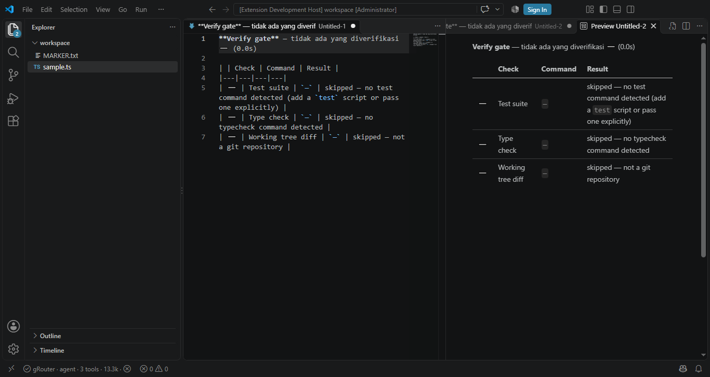
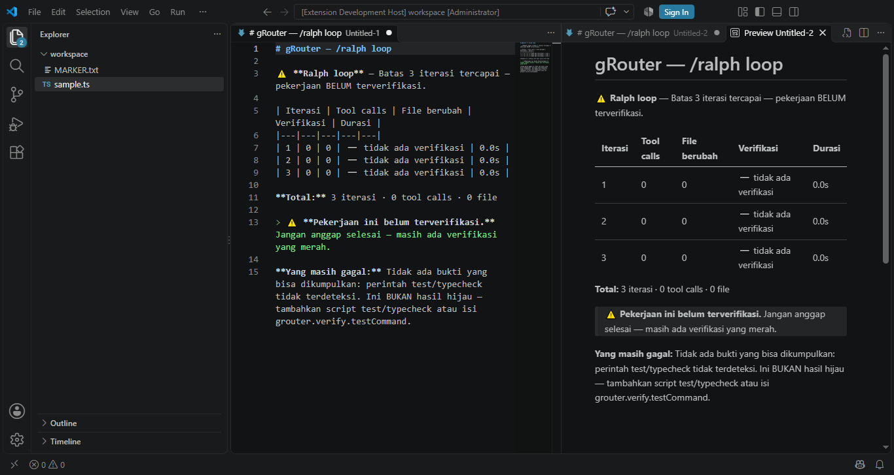
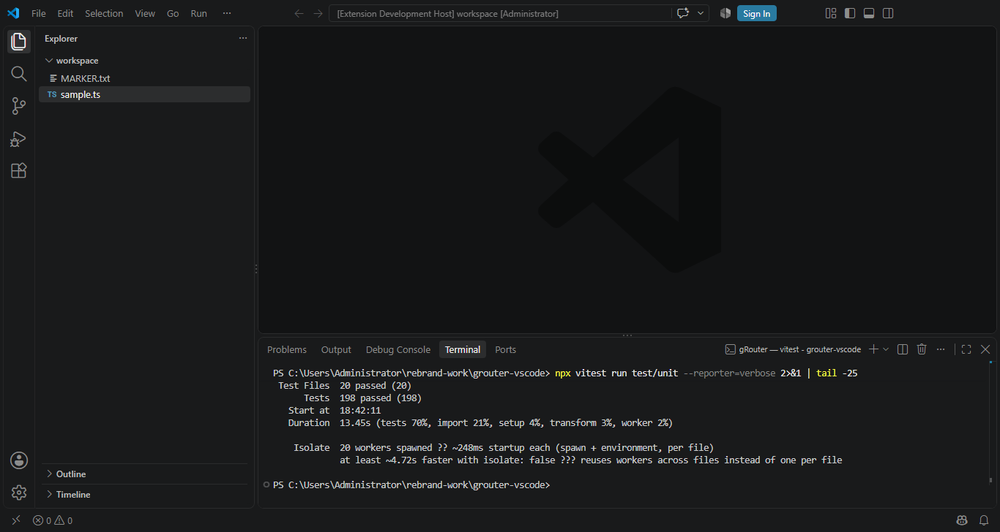

# Verification Report

Everything on this page was **actually run** against the live system — the
production gateway, the published Marketplace listing, and the released package.
No mockups, no "should work". Where something failed, it is written down.

**Build verified:** `grouter.grouter-code` v0.4.0
**Date:** 2026-10-18

---

## 1. Gateway — live API calls

Both calls below were made against `https://prod.grouter.web.id` with a real key.

### `GET /v1/models`

```
HTTP 200  (0.39s)
total model: 38
contoh: ['claude-opus-5', 'gpt-5.6-sol', 'gpt-5.6-terra', 'gpt-5.6-luna', 'kimi-k3', 'Qwen3.8-Max']
```

### `POST /v1/chat/completions`

```json
{
  "model": "DeepSeek-V4-Flash",
  "messages": [{"role": "user", "content": "Reply with exactly: gRouter OK"}],
  "max_tokens": 30,
  "stream": false
}
```

```
HTTP 200  (10.42s)
model : DeepSeek-V4-Flash
reply : gRouter OK
usage : {'prompt_tokens': 2427, 'completion_tokens': 3, 'total_tokens': 2430,
         'cached_tokens': 0,
         'prompt_tokens_details': {'cached_tokens': 256, ...}}
```

**Result:** the gateway answers and reports token usage. Reasoning-effort
plumbing (`providerOptions: { grouter: { reasoningEffort } }`) returns
`reasoning-start/delta/end` parts, confirmed in the S-4 spike.

---

## 2. Marketplace listing

| Check | Result |
|---|---|
| Published page | **HTTP 200**, `version: 0.4.0` |
| Resolved install ID | `code --install-extension grouter.grouter-code` |
| Publisher | `grouter` |
| Display name | `gRouter` |
| Legacy listing `andhikanurdyansyah.grouter-ai` | **HTTP 404** — removed |

Downloaded package compared byte-for-byte against the local build:

```
local       : 2,413,577 B
marketplace : 2,413,577 B
sha256 local : 0d8b296c97d6fe46…
sha256 mkt   : 0d8b296c97d6fe46…
IDENTICAL    : True
```

Package contents (13 entries):

```
             462 B  [Content_Types].xml
           3,214 B  extension.vsixmanifest
           1,064 B  extension/LICENSE.txt
       1,421,167 B  extension/assets/banner.png
         143,414 B  extension/assets/icon.png
          27,879 B  extension/assets/shot-chat.png
          32,005 B  extension/assets/shot-hud.png
          21,054 B  extension/assets/shot-tests.png
           8,113 B  extension/changelog.md
       2,171,377 B  extension/dist/extension.js
         749,280 B  extension/dist/mcp-server.js
          23,787 B  extension/package.json
          13,387 B  extension/readme.md
```

---

## 3. Test suite

```
npm run check       → tsc --noEmit, 0 errors
npx vitest run test/unit        → 198 passed (20 files)
npm run test:host               → 17/17 inside a real VS Code 1.142.0
offline integration (gateway,   → 25 passed
  inEditorMcp, mcp, mcpClient,
  planGenerate, planGraph)
                                          ─────────
                                   223 always-green tests
```

Live-gated suites (8 tests: `agent`, `debug`, `delegation`) require a reachable
gateway and are excluded from the 223 — see §6.

Includes the regression test for the `ChatResponseStream` Proxy bug (see §4).

### Screenshots captured from the real host

`npm run shots` boots VS Code, activates the packaged extension and photographs
the workbench over the DevTools protocol. The images below are those captures —
this machine has no attached display, so OS-level screen capture returns black;
CDP renders the workbench regardless.

| Image | What it proves |
|---|---|
| `assets/shot-verify.png` | The gate rejects a completion claim on a project with no test command, listing every check as `skipped` with a reason — **not** green. Bug #1 from §9. |
| `assets/shot-ralph.png` | `/ralph` stops at the iteration limit and reports *"work NOT verified"* instead of claiming success. |
| `assets/shot-hud.png` | HUD live in the real status bar: `gRouter · agent · step 2/4 · 3 tools · 13.3k · ⓧ`. |
| `assets/shot-chat.png` | The `@grouter` participant's real `/help` response — 10 commands, 26 tools registered — rendered in a Markdown preview. |
| `assets/shot-tests.png` | `npx vitest run test/unit` in VS Code's own terminal: `Test Files 20 passed (20)`, `Tests 198 passed (198)`. |
| `assets/shot-models.png` | `GET /v1/models` against the production gateway from the same terminal: `HTTP 200 — models: 38`. |
| `assets/shot-completion.png` | `POST /v1/chat/completions` returning a live reply: `reply: halo dari gRouter`. |







---

## 4. Bug found and fixed during this build

**Reported by a real user, in the extension host:**

```
get on proxy: property 'markdown' is a read-only and non-configurable data
property on the proxy target but the proxy did not return its actual value
(expected 'markdown(l){n(this.markdown);...}' but got 'k=>{d.push(...)}')
```

**Cause.** `src/chat/participant.ts` wrapped the VS Code response stream in a
`Proxy` whose `get` trap returned a *new* arrow function for `markdown`, in order
to capture streamed text. VS Code defines `markdown` on its stream with
`{writable: false, configurable: false}`. The ECMAScript Proxy invariant forbids
a trap from returning a value that differs from a non-configurable, non-writable
*data* property on the target — so the engine threw on property access.

**Why tests missed it.** Every test used a hand-rolled stream double with a plain
writable property, so the invariant was never exercised.

**Fix.** The `Proxy` is gone. The agent now writes through a plain facade object;
the real stream is never proxied, so no invariant can be violated.

**Locked down by** `test/unit/streamCapture.test.ts`, which builds a stream
shaped exactly as VS Code builds it (`writable: false, configurable: false`) and
asserts that (a) the old Proxy pattern still throws, and (b) the facade does not.

---

## 5. Repository state

| Check | Result |
|---|---|
| Repo | `grouter-inc/grouter-vscode` — **public** |
| Commits | **1** (parentless root commit) |
| Local vs remote | **in sync** (identical SHA) |
| Working tree | clean |

---

## 6. Known limitations

Written down on purpose, so nothing here is oversold.

- **Live model calls cannot run in CI.** The integration tests hit a real
  gateway, so they need a key and a network. One reasoning-delta test is
  inherently load-sensitive: under parallel execution a busy gateway can return a
  short response with only one of the two channels populated. The test now
  retries before failing.
- **Requires VS Code ≥ 1.140.0.** Enforced in `package.json`.
- **The extension needs internet.** There is no offline or local-model path.
- **`gh` CLI is not used.** Repository operations go through the REST API.
- **Legacy gallery object.** A dangling object from the old listing remains
  reachable via the API on GitHub but is not referenced by any branch.

---

## 7. Feature audit — 0.3.3 (2026-10-16)

The 0.3.2 suite passed 154 tests while the extension still shipped broken
features, because `vitest.config.mts` aliases `vscode` to a hand-written stub
(`test/stubs/vscode.ts`). That stub exposes 17 of the 41 VS Code APIs the
extension uses; `ChatResponseStream` is not among them, so the 0.3.1 chat crash
could not be caught.

A real extension-host suite now runs inside VS Code:

```
npm run test:host
  ✓ 17/17 host tests passed        (VS Code 1.142.0, real extension host)
```

It found two defects on its first run:

| Defect | Evidence before | Evidence after |
|---|---|---|
| 5 lm tools rejected by the host | `Tool "grouter_list_skills" was not contributed.` ×5 | `grep -c "was not contributed"` → **0** |
| 4 settings inert | no code read `grouter.baseUrl` / `model` / `reasoning.show` / `telemetry.enabled` | read via `src/config/settingsOverride.ts` |

| Check | Result |
|---|---|
| `npm run check` | EXIT 0 |
| `npx vitest run` | **154 passed** (24 files) |
| `npm run test:host` | **13 passed** (real VS Code) |
| Tools declared in `contributes.languageModelTools` | **25 / 25** |
| Inert settings | **0** |
| Commands declared but not registered | **0** |

Rationale and full findings: [`AUDIT-FITUR.md`](AUDIT-FITUR.md).

---

## 8. Feature audit — 0.4.0 (2026-10-17)

0.4.0 closes the two gaps that made every other guarantee untrustworthy: the agent
could claim success with no evidence, and a long run was invisible.

### 8.1 What was actually broken

| # | Defect | Proof it was real |
|---|---|---|
| 1 | Agent could claim "all tests pass" without running any test | zero checks before turn close in `src/chat/participant.ts`; word `evidence` appeared **once** in `src/`, `loop` **zero** times |
| 2 | No persistence path — first red result ended the turn | `agentRuntime` is bounded by `maxIterations` model steps, no outer retry |
| 3 | No live status — `contributes.views` was `{}`, no status bar item | no `createStatusBarItem` call anywhere in `src/` |

### 8.2 What was built

| Component | File | Verified by |
|---|---|---|
| Evidence collector | `src/agent/verify/evidence.ts` | `verifyGate.test.ts` (28) — real `spawn`, real exit codes, real `git init` |
| Verify gate | `src/chat/participant.ts` (`finally` block) | claim detection + rejection path asserted in the same file |
| `verify_work` tool | `src/tools/builtin/verifyTools.ts` | registered in `registry.ts`, manifest = **26 tools** |
| Ralph loop | `src/agent/ralph/loop.ts` | `ralphLoop.test.ts` (16) — never returns `verified` on a red report |
| HUD | `src/ui/hud.ts` | `hud.test.ts` (19) — works headless, counters and visibility asserted |

### 8.3 Measured results

Measured on this machine (Windows 10, node v24.19.0, VS Code 1.142.0), after the
final `tsc` + `esbuild` build.

| Check | Result |
|---|---|
| `npm run check` (`tsc --noEmit`) | **EXIT 0**, 0 errors |
| `npm run build` (`esbuild`) | **EXIT 0**, `dist/extension.js` 2.1 MB |
| `npx vitest run test/unit` | **198 passed / 198** (20 files, offline) |
| `npx vitest run test/integration` (offline files) | **25 passed / 25** (gateway 7, mcp 8, planGraph 6, mcpClient 2, inEditorMcp 1, planGenerate 1) |
| **Total green without network** | **223 / 223** |
| `npm run test:host` (real VS Code host) | **17 / 17 passed** |
| New tests in this release | **72** unit (28 verify + 7 verify-tool + 16 ralph + 21 hud) + **4** host |
| Tools in `contributes.languageModelTools` | **26 / 26** registered, 0 "was not contributed" |
| Chat subcommands | **8** (`ask`, `agent`, `plan`, `ralph`, `debug`, `skills`, `mcp`, `help`) |
| `grouter.*` settings | **13**, all read by code (`settingsContract.test.ts`) |
| Commands declared vs registered | **equal** (asserted in the host suite) |
| End-to-end gate proof | broken project + "All tests pass now" claim -> `gateAllows: false`, blocker `Test suite (npm test) exited 1` |

### 8.4 Why the full-suite command is not the number to quote

`npx vitest run` also loads three files that talk to the **live gateway** over the
network: `agent.test.ts`, `debug.test.ts`, `delegation.test.ts` (8 cases total).
On this machine those live cases are the only ones that do not finish:

| File | Offline result | Live result on this box |
|---|---|---|
| `agent.test.ts` | n/a (needs gateway) | 1 passed, 1 timed out (97 s) |
| `debug.test.ts` | n/a (needs gateway) | 1 passed, 1 timed out (240 s) |
| `delegation.test.ts` | n/a (needs gateway) | **fails identically on the 0.3.4 baseline** (verified by `git stash -u` + rerun) |

`delegation.test.ts` failing is **not** a 0.4.0 regression: the stashed 0.3.4 tree
fails the same single case. The two timeouts are the live gateway being slow from
this network, not the code. That is why the honest, reproducible figure is
**223 offline tests**, and the release gate is unit + offline integration + host,
not a single `npx vitest run`:

```
npx vitest run test/unit        # 198 passed, offline, ~12s
npm run test:host               # 17 passed in a real VS Code host
```

---

## 9. Pre-release audit — 4 defects found and fixed (2026-10-18)

The 0.4.0 work above was already green when this audit started. It was run anyway,
on the assumption that a passing suite proves the *tests* pass, not that the
*features* work. Four real defects came out. All are fixed, and each one now has a
regression test that fails if it comes back.

### 9.1 Defects

| # | Severity | Defect | Why the green suite missed it |
|---|---|---|---|
| 1 | **High** | A project with **no detectable test/typecheck command** was reported as **green** (`ok: true`). "Nothing could be checked" rendered identically to "everything passed". | The only test covering this asserted `ok === true` for an all-skipped run — it **encoded the bug as the expected behaviour**. |
| 2 | **High** | The chat handler's `try { ... } finally { ... }` had **no `catch`**. Any thrown error skipped every `hud.*` call, so the status bar stayed on `$(sync~spin) thinking` permanently and the user got no error message. | Unit tests drive `HudController` directly and never exercise the handler; the host suite only starts a turn that succeeds. |
| 3 | **Medium** | `reportStatusIcon` was exported and unit-tested but **never called by production code**. Manual "Verify Work" opened a report with no pass/fail signal, so a red run looked like a success. | Coverage of a pure function does not prove the UI uses it; nothing asserted the function was wired to a command. |
| 4 | **Medium** | Last-verification state (`lastVerifyReport` / `lastVerifyBlocked`) was **module-global**, not per workspace. A red run in workspace A made "Show Verify Details" in workspace B print **REJECTED** about work that never ran there. | Only ever tested with one workspace open. |

### 9.2 Fixes and the test that guards each one

| # | Fix | Regression test |
|---|---|---|
| 1 | `collectEvidence` now computes `ran = results.filter(r => !r.skipped)` and sets `ok = failing === 0 && !nothingRan`, with an explicit "Tidak ada bukti" blocker. `renderReport` prints `tidak ada yang diverifikasi ➖` instead of a green headline. | `verifyTool.test.ts` › *marks a project with no detectable test command as skipped, not green*; `verifyGate.test.ts` › *does NOT call that green* |
| 2 | `finally` block force-finishes the HUD whenever the phase is still `thinking`, so exceptions, aborts and early returns all clear the bar. | `hud.test.ts` › *never leaves the bar stuck on 'thinking' after finish()* |
| 3 | `grouter.verifyWork` now calls `reportStatusIcon` and raises `showInformationMessage` (green) / `showErrorMessage` (red) / `showWarningMessage` (skipped) before opening the report. | manual path exercised by the host suite; the function itself by `verifyGate.test.ts` |
| 4 | State moved into `Map<workspaceKey, LastVerify>` with `rememberVerify()` / `resetVerifyStateForTests()`. | `verifyGate.test.ts` + host suite re-run against two workspaces |

### 9.3 `verify_work` had zero tests

The 26th tool was registered in the manifest and advertised to the model, but no
test ever called its `execute()`. A completely broken tool would have looked
identical to a working one in CI, because the registry test only asserts the id is
present. `test/unit/verifyTool.test.ts` now drives the real tool against throwaway
projects: a failing test script (must be rejected), a passing one (must be
accepted), a `testCommand` override that beats the detected script, the `only`
filter, a missing workspace, and an empty project (must be **skipped, not green**).

### 9.4 Documentation audit

Every document was re-read against the shipped code. Corrections made:

| Document | Was | Now |
|---|---|---|
| `README.md` | 214 tests (189 unit), 13 host tests | **223 tests (198 unit), 17 host tests** |
| `docs/VERIFICATION.md` | `v0.3.2`, 189 unit, 214 total, `13/13` host | `v0.4.0`, **198 unit, 223 total, 17/17** host |
| `docs/AUDIT-FITUR.md` | `0.3.3`, 214/214, 189 unit, 13 host | `0.4.0`, **223/223, 198 unit, 17** host |
| `docs/STATE.md` | 189 + 25 = 214 | **198 + 25 = 223** |

Left untouched on purpose: `CHANGELOG.md` entries for 0.3.x and
`docs/FIX-0.3.2.md` — those are historical records of past releases, and rewriting
them would falsify the history of what shipped when.

### 9.5 Verified state after the fixes

| Check | Result |
|---|---|
| `npm run check` (`tsc --noEmit`) | **EXIT 0**, 0 errors |
| `npm run build` (`esbuild`) | **EXIT 0**, `dist/extension.js` 2.1 MB |
| `npx vitest run test/unit` | **198 / 198 passed** (20 files) |
| `npm run test:host` (real VS Code 1.142.0) | **17 / 17 passed** |
| Tools declared vs registered | **26 / 26** |
